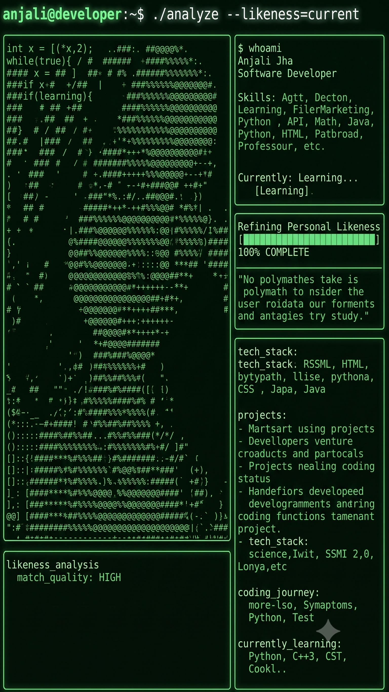

<div align="center">

<!-- ANIMATED TERMINAL HEADER -->


<br/><br/>

<table>
<tr>
<td width="42%" align="center" valign="middle">

<!-- YOUR GREEN ASCII PORTRAIT -->


</td>
<td width="58%" align="left" valign="middle">

### `> SYSTEM_STATUS: OPERATIONAL`

*"Till death, all defeats are psychological."*


<br/>

<a href="https://linkedin.com/in/anjali-jha-aab39128b"></a>
<a href="https://leetcode.com/u/anjali_jha123"></a>
<a href="https://x.com/anjali_jha_tech"></a>
<a href="mailto:ajha30024@gmail.com"></a>

<br/>

```text
USER     : techie-anjali
ROLE     : Backend Developer in Progress
PRIMARY  : Java | Spring Boot
MISSION  : Build. Learn. Improve.
```

</td>
</tr>
</table>

</div>

---

### ⚙️ `$ ./tech_stack --view=detailed`

| Domain | Stack & Technologies |
|:---|:---|
| **Languages** | `Java` `C++` `Python Basics` `SQL` |
| **Backend & APIs** | `Spring Boot` `JDBC` `REST APIs` |
| **Databases** | `MySQL` `Oracle` |
| **Networking & Systems** | `C++` `PCAP` `Packet Analysis` |
| **Tools** | `Git` `GitHub` `Postman` `VS Code` |
| **Core CS** | `DSA` `DBMS` `Operating Systems` `Computer Networks` |

---

### 🚀 `$ ./projects --active`

#### 01. [UPI Offline Mesh](https://github.com/techie-anjali/upi-offline-mesh)

- **Architecture:** Java 21 · Spring Boot
- **Security:** AES-256 payload encryption and RSA handshake
- **Reliability:** Idempotent request deduplication and TTL-based replay protection
- **Focus:** Offline payments and Bluetooth Low Energy (BLE) communication

#### 02. [DPI Engine](https://github.com/techie-anjali/DPI-Engine)

- **Stack:** C++ · PCAP
- **Focus:** Deep packet inspection and network traffic analysis
- **Goal:** Understand low-level networking and packet processing

#### 03. [Agri-Smart](https://github.com/techie-anjali/Agri-Smart)

- **Stack:** TypeScript
- **Context:** Smart India Hackathon prototype
- **Focus:** Intelligent agricultural monitoring and workflows

---

### 📊 `$ github --stats`

<div align="center">


<br/><br/>


</div>

---

### `$ connect --with-me`

- **GitHub:** [@techie-anjali](https://github.com/techie-anjali)
- **LinkedIn:** [Connect with me](https://linkedin.com/in/anjali-jha-aab39128b)
- **LeetCode:** [Solve problems with me](https://leetcode.com/u/anjali_jha123)

<div align="center">

```text
[ LEARN ] ---> [ BUILD ] ---> [ DEBUG ] ---> [ REPEAT ]
```

*One commit at a time. One problem at a time.*

</div>
